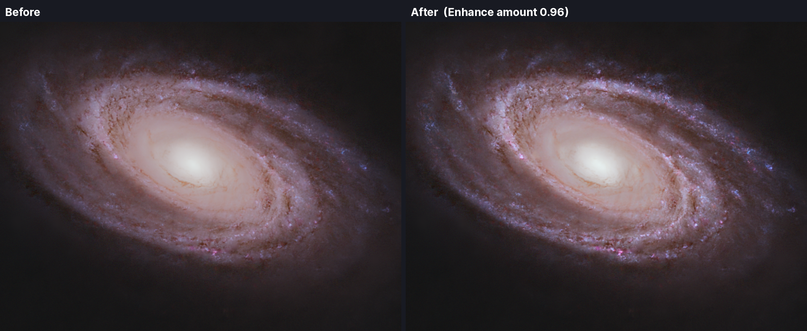
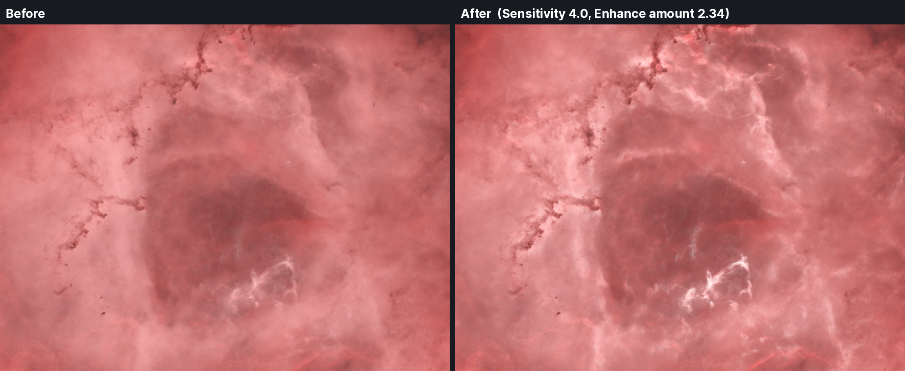

# PixInsight Scripts

## Dust Lane Enhancer
Before & After Images:

Deepens dust lanes and dark filaments. It finds them by their **shape** (long, dark ridges), not by their brightness, and darkens only where it found one. Flat sky, stars and anything brighter than its surroundings are left alone.

- Works on the active image. With **Create a new image** ticked (the default) the result opens as a new image and the original is not changed; unticked, **Apply** changes the image itself, and PixInsight's Undo takes it back.
- Works through the image's **mask**: areas shown red are left unchanged and clear areas get the full effect, in the preview and on Apply. The preview shows the mask in red too (Show mask). Inverted masks work too.
- A built-in preview, with zoom and pan. From 60% zoom the preview shows full resolution, exactly what Apply will produce there.
- Use it on a **stretched** image, preferably a **starless** one: bright stars can leave a faint ring-shaped response.

### Settings

| Setting | What it does |
|---|---|
| Smallest structure (px) | The narrowest lane to look for, in pixels of the full-size image. |
| Largest structure (px) | The widest lane to look for. Also sets how wide an area each pixel is compared with. |
| Sensitivity | How faint a lane may be and still be found. Higher reaches fainter structure but picks up more noise. |
| Enhance amount | How much the lanes found are deepened. 0 changes nothing. |
| Show detection map | Shows what was found (white = a lane) instead of the result. The map always opens as a new image. |
| Create a new image | Ticked: the result opens as a new image. Unticked: Apply changes the active image itself (Undo takes it back). |

### Installing

**From PixInsight's update system**

1. In PixInsight choose *Resources > Updates > Manage Repositories*.
2. Press *Add* and enter:
   `https://raw.githubusercontent.com/Astro5hed/Pixinsight-Scripts/main/repository/`
3. Choose *Resources > Updates > Check for Updates*, install, and restart PixInsight when asked.
4. The script is under *Script > AstroShed > Dust Lane Enhancer*.

**By hand**

1. Download `DustLaneEnhancer.js` from this page.
2. In PixInsight choose *Script > Execute Script File* and pick it. To have it in the Script menu, use *Script > Feature Scripts*, add the folder you saved it in, and press *Done*.

### Versions

- **1.3.3** - the preview now shows the image's mask in red (Show mask), as PixInsight does.
- **1.3.2** - now code-signed by AstroShed (Certified PixInsight Developer). No other changes.
- **1.3.1** - now works through the image's mask (as PixInsight shows it in red), in the preview and on Apply.
- **1.3.0** - new window layout: large title, Create a new image option, and a big Apply button (was Run).
- **1.2.9** - shows its author and website (Stewart Oliver, AstroShed).
- **1.2.8** - fixed Run stopping with "read-only image" when making the result.
- **1.2.7** - its own AstroShed folder in the Script menu, and its icon now shows.
- **1.2.4 - 1.2.6** - icon work.
- **1.2.4** - added its own icon.
- **1.2.3** - removed a harmless warning shown in the console when the script starts.
- **1.2.2** - first public version.

### How it works

A Frangi "vesselness" measure (Frangi et al., 1998) is taken at four sizes between Smallest and Largest structure on a reduced working copy of the luminance. Each size is weighted by its size squared, so wide shallow lanes are not lost, and the threshold is set from the image's own noise floor, so bright stars do not drown faint lanes. The result is then `image + amount * map * min(image - blurred image, 0)`, so a lane gets darker and nothing is ever made brighter.

## Bright Filament Enhancer
Before & After Images:

Brightens thin bright filaments: nebula filaments and edges, emission tendrils, galaxy arms. It finds them by their **shape** (long, bright ridges), not by their brightness, and brightens only where it found one. Flat sky and anything darker than its surroundings are left alone, nothing is ever made darker, and the brightest parts ease off towards white so they never clip. It is the partner to Dust Lane Enhancer: one lifts the bright structure, the other deepens the dark.

- Works on the active image. With **Create a new image** ticked (the default) the result opens as a new image and the original is not changed; unticked, **Apply** changes the image itself, and PixInsight's Undo takes it back.
- Works through the image's **mask**: areas shown red are left unchanged and clear areas get the full effect, in the preview and on Apply. The preview shows the mask in red too (Show mask). Inverted masks work too.
- A built-in preview, with zoom and pan. From 60% zoom the preview shows full resolution, exactly what Apply will produce there.
- Use it on a **stretched, starless** image. Stars matter here: in a dense star field they raise the level the script uses to decide what counts as a filament, and it then finds very little.

### Settings

| Setting | What it does |
|---|---|
| Smallest structure (px) | The narrowest filament to look for, in pixels of the full-size image. |
| Largest structure (px) | The widest filament to look for. Also sets how wide an area each pixel is compared with. |
| Sensitivity | How faint a filament may be and still be found. Higher reaches fainter structure but picks up more noise. |
| Enhance amount | How much the filaments found are brightened. 0 changes nothing. |
| Show detection map | Shows what was found (white = a filament) instead of the result. The map always opens as a new image. |
| Create a new image | Ticked: the result opens as a new image. Unticked: Apply changes the active image itself (Undo takes it back). |

### Installing

It comes from the same update repository as Dust Lane Enhancer: add the address above (*Resources > Updates > Manage Repositories*), then *Check for Updates* and restart PixInsight. It is under *Script > AstroShed > Bright Filament Enhancer*. If you already have the repository added, just check for updates.

By hand: download `BrightFilamentEnhancer.js` from this page and use *Script > Execute Script File*.

### Versions

- **1.1.2** - first public version. Code-signed by AstroShed (Certified PixInsight Developer).

### How it works

The same method as Dust Lane Enhancer, turned the other way: a Frangi "vesselness" measure (Frangi et al., 1998) of bright ridges is taken at four sizes between Smallest and Largest structure on a reduced working copy of the luminance, each size weighted by its size squared, with the threshold set from the image's own noise floor. The lift is `map * max(image - blurred image, 0)`, and the result is `image + (1 - image) * (1 - exp(-amount * lift / (1 - image)))`, which is `image + amount * lift` for small lifts but eases off towards white.

From the Dust Lane Enhancer tool by AstroShed (astroshed.co.uk).
